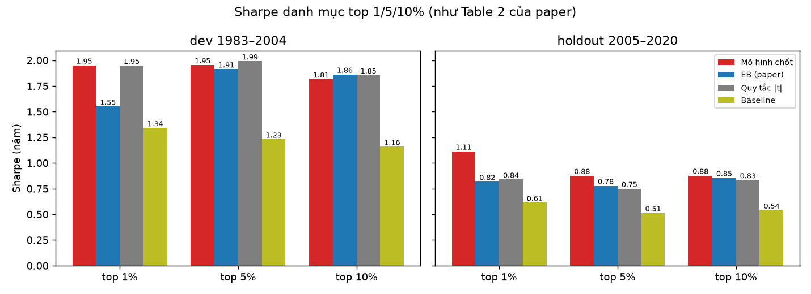
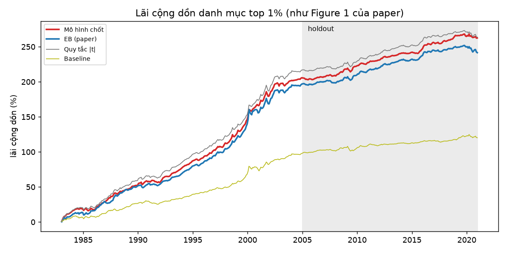
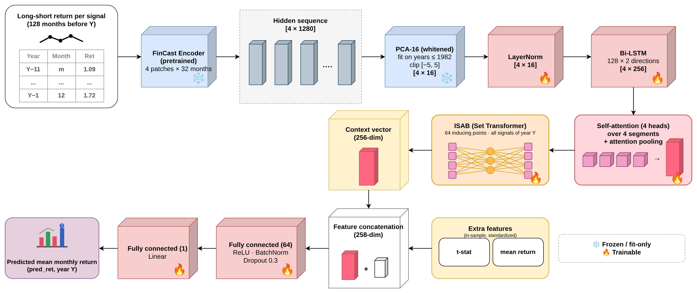

# AI_Finance — Chọn chiến lược long–short bằng FinCast và attention

Mỗi đầu năm Y (1983–2020), mô hình dự báo **lợi suất trung bình tháng của năm Y** cho từng chiến lược long–short trong họ **Accounting EW** (khoảng 26.000 chiến lược mỗi năm), chỉ bằng dữ liệu trước năm Y. Đây là đại lượng mà Empirical Bayes (EB) trong *High-Throughput Asset Pricing* (Chen & Dim, [arXiv 2311.10685](https://arxiv.org/abs/2311.10685)) dự báo. Mô hình được so với EB mining, naive mining (xếp theo \|t\|) và baseline.

**Kết quả chính:** danh mục top 1% của mô hình có Sharpe cao hơn EB mining ở giai đoạn phát triển (1,95 so với 1,55), holdout (1,11 so với 0,82) và cả kỳ (1,62 so với 1,27). Cả ba chênh lệch đều có ý nghĩa thống kê (HAC p = 0,032 / 0,028 / 0,005).

---

## 1. Kết quả

Số là **Sharpe năm hoá** của danh mục top 1% / 5% / 10% theo luật của Chen & Dim: đảo dấu theo dự báo, xếp theo Sharpe dự báo, chia đều, giữ 12 tháng, trước chi phí giao dịch. Dev = 1983–2004, holdout = 2005–2020. Bảng gốc ở [results/](results/).

| Phương pháp | Dev | Holdout | Cả kỳ 1983–2020 |
|---|---|---|---|
| Baseline model (FinCast → Bi-LSTM → attention → FC) | 1,34 / 1,23 / 1,16 | 0,61 / 0,51 / 0,54 | 1,07 / 0,97 / 0,94 |
| Naive mining (xếp theo \|t\|) | 1,95 / 1,99 / 1,85 | 0,84 / 0,75 / 0,83 | 1,52 / 1,51 / 1,47 |
| EB mining (Chen & Dim) | 1,55 / 1,91 / 1,86 | 0,82 / 0,78 / 0,86 | 1,27 / 1,48 / 1,48 |
| **Mô hình đề xuất** | **1,95** / 1,95 / 1,82 | **1,11 / 0,88 / 0,88** | **1,62 / 1,54** / 1,46 |



**Top 1% so với EB mining** ([results/selection.csv](results/selection.csv)):

| Giai đoạn | EB: lãi %/năm (t-stat) | Mô hình: lãi %/năm (t-stat) | p (HAC) so với EB | p (HAC) so với naive |
|---|---|---|---|---|
| Dev | 8,95 (7,26) | **9,36 (9,15)** | **0,032** | 0,970 |
| Holdout | 2,79 (3,27) | **3,54 (4,45)** | **0,028** | **0,028** |
| Cả kỳ | 6,36 (7,84) | **6,91 (9,97)** | **0,005** | 0,104 |

- **Khi hai phương pháp chọn khác nhau**, các chiến lược chỉ mô hình chọn có Sharpe 1,63 trên cả kỳ, còn các chiến lược chỉ EB chọn có Sharpe 0,85.
- **Kiểm tra nhiễu (Ticker):** chiến lược Ticker xếp theo chữ cái tên mã cổ phiếu nên vô nghĩa về kinh tế. Mô hình chưa từng thấy họ này khi học. Trong tập gộp, Ticker chiếm 43,5% số chiến lược nhưng chỉ chiếm 0,19% top 1% của mô hình, nghĩa là mô hình nhận ra đó là nhiễu.
- **Sau 2004**, khi khả năng dự báo của mọi phương pháp yếu đi, mô hình vẫn có Sharpe top 1% cao nhất ở cả hai giai đoạn con: 2005–2012 là 1,25 so với 1,11 của EB, 2013–2020 là 0,99 so với 0,58.



---

## 2. Mô hình



Mỗi khối nhận đầu ra của khối trước và giải quyết một khó khăn của bài toán. `n` là số chiến lược của **cùng một năm**.

| # | Khối | Đầu ra | Học? | Vai trò |
|---|---|---|---|---|
| 0 | 128 tháng lãi trước năm Y, nhân dấu | `[n, 128]` | – | giữ hình dạng chuỗi lợi suất, thứ mà t-stat bỏ mất |
| 1 | **FinCast** (pretrained, đóng băng), 4 patch × 32 tháng | `[n, 4, 1280]` | không | đọc chuỗi bằng mô hình nền tài chính, không phải học mô hình chuỗi lớn trên dữ liệu nhiễu |
| 2 | **PCA trắng hoá 16 chiều** (fit trên năm ≤ 1982), kẹp [−5, 5] | `[n, 4, 16]` | không | nén 5.120 số xuống mức mà ~26.000 chiến lược mỗi năm đủ để học |
| 3 | LayerNorm → **Bi-LSTM** (128 mỗi chiều) | `[n, 4, 256]` | có | đọc 4 patch theo thứ tự thời gian |
| 4 | **Self-attention** 4 đầu giữa 4 patch + **attention pooling** | `[n, 256]` | có | học đoạn lịch sử nào quan trọng cho bài toán dự báo |
| 5 | **ISAB** (Set Transformer, 64 điểm tóm tắt) | `[n, 256]` | có | so mỗi chiến lược với cả năm; chi phí tuyến tính theo `n` |
| 6 | Ghép **t-stat, lãi trung bình** → FC 64 → ReLU → BatchNorm → Dropout 0,3 → 1 | dự báo | có | dựa trên t-stat và học thêm phần t-stat chưa giải thích |

Phần học được khoảng 1,57 triệu tham số, đặt trên một bộ mã hoá đóng băng.

**Nhãn học:** Sharpe năm sau − Sharpe trung bình của năm − **nền \|t\|** (b × \|t\| chuẩn hoá, b ước lượng bằng hồi quy ridge trên 15 năm trước), cắt ở phân vị 1% và 99%. Mạng học phần hiệu quả tương lai mà t-stat chưa giải thích, đo tương đối với các chiến lược cùng năm.

**Huấn luyện:**
- Loss: Huber × trọng số năm (kiểu Holen et al.).
- Tối ưu: AdamW, learning rate 1e-3, weight decay 1e-2.
- Walk-forward: học trên các năm ≤ Y−2, chọn vòng tốt nhất trên năm Y−1, học lại mỗi năm.
- Mô hình đề xuất là seed 1, chọn trong 6 seed bằng Sharpe trung bình 1995–2004.

**Ablation** (đổi một thành phần, học 3 lần mỗi cấu hình; Sharpe trung bình top 1/5/10%):

| Cấu hình | Dev | Holdout |
|---|---|---|
| **Cấu hình đề xuất (học lại)** | **1,85** | **0,84** |
| FinCast khởi tạo ngẫu nhiên (không pretrained) | 1,80 | 0,66 |
| PCA 8 thành phần | 1,95 | 0,67 |
| PCA 32 thành phần | 1,85 | 0,77 |
| PCA 64 thành phần | 1,64 | 0,74 |

- **FinCast pretrained** và **PCA 16 chiều** cho holdout tốt nhất.
- **Nhãn** "Sharpe trừ trung bình năm" là cải thiện lớn nhất trong quá trình phát triển: dev từ 1,37 lên 1,84, holdout từ 0,69 lên 0,81.

---

## 3. Chạy lại

Cần **GPU NVIDIA**. Đã chạy trên RTX 5060 Ti 16 GB, CUDA 12.8; mỗi seed khoảng 7 phút, dựng cache FinCast + PCA khoảng 9 phút.

```bash
# 1. Môi trường
conda create -n paper python=3.13 -y && conda activate paper
pip install -r requirements.txt

# 2. Mã nguồn FinCast của tác giả (trọng số Vincent05R/FinCast v1.pth tự tải từ Hugging Face)
git clone https://github.com/vincent05r/FinCast-fts.git Research/tools/FinCast-fts

# 3. Dữ liệu: tải CSV về data_raw/ (bảng ngay dưới)

# 4. Dựng cache: ma trận lãi, bảng (chiến lược, năm), FinCast + PCA16
cd code
python -c "import data; ids, wide = data.load_returns(); T = data.load_table(); data.extract_tokens(T, ids, wide)"

# 5. Học và lưu dự báo, checkpoint mỗi năm
python run.py 1

# 6. Bảng kết quả -> results/*.csv
python report.py
```

**Không học lại:** trọng số mô hình đề xuất nằm sẵn ở `code/checkpoints/final_s1/Y1983.pt … Y2020.pt` (38 năm). Dự báo của mô hình và của baseline nằm ở `results/forecasts/`. `report.py` dùng các dự báo này để tái lập đúng các bảng trên. GPU không tất định, nên học lại cùng seed sẽ cho số hơi khác; dùng checkpoint đã lưu thì dự báo cố định.

**Dữ liệu** (không nằm trong Git vì vượt giới hạn dung lượng; đặt vào `data_raw/`):

| Dữ liệu | Nơi tải |
|---|---|
| Họ **kế toán** (`DataMinedLongShortReturnsEW.csv`, danh sách chiến lược) | [Google Drive của tác giả](https://drive.google.com/drive/folders/16RqeHNyU5gcqjRUvqSeOfQCxu_B2mfcZ) |
| Họ **lợi suất quá khứ** và **Ticker** (thư mục *Strategy Returns*) | [Dropbox của tác giả](https://www.dropbox.com/scl/fo/qd3aw9x8eje18tiy7gqm2/h/Strategy%20Returns?dl=0&subfolder_nav_tracking=1) |
| Trang dữ liệu của nhóm tác giả | [sites.google.com/site/chenandrewy/Data](https://sites.google.com/site/chenandrewy/Data) |
| Paper gốc | [arXiv 2311.10685](https://arxiv.org/abs/2311.10685) |

`data_sample/` có trích mẫu nhỏ của từng CSV để xem cấu trúc.

---

## 4. Cấu trúc

```
AI_Finance/
├── README.md
├── requirements.txt
├── code/
│   ├── data.py          CSV → bảng (chiến lược, năm) → cửa sổ 128 tháng → FinCast → PCA16; EB làm mốc so sánh
│   ├── model.py         kiến trúc, từng khối
│   ├── train.py         nhãn, nền |t|, trọng số năm; học walk-forward; checkpoint mỗi năm
│   ├── evaluate.py      danh mục top 1/5/10%, kiểm định Sharpe HAC / bootstrap, IC
│   ├── run.py           học và lưu dự báo
│   ├── report.py        bảng kết quả từ dự báo đã lưu
│   └── checkpoints/final_s1/   trọng số mô hình đề xuất, mỗi năm một file
├── results/             sharpe.csv, selection.csv, ic.csv, forecasts/
├── docs/figures/        hình kiến trúc và kết quả
├── data_raw/            CSV gốc (tải theo bảng trên)
├── data_sample/         trích mẫu dữ liệu (tạo lại: python scripts/create_data_samples.py)
└── scripts/             create_data_samples.py
```
