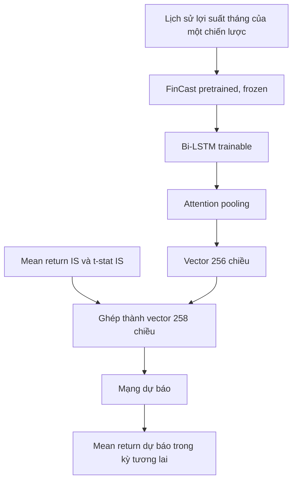

# Giải thích nghiên cứu Asset Pricing từ tổng quát đến chi tiết

Tài liệu dành cho thành viên mới tham gia nghiên cứu. Được tổng hợp và đối chiếu lại với thư mục `Docs/Asset pricing` ngày 28/09/2026.

## 1. Điều cần biết đầu tiên

Thư mục có **52 PDF, 6 file Word, 6 PowerPoint và 1 Excel**. File ZIP chứa nội dung trùng với thư mục `Docs`.

Đây là thư mục tài liệu của một nghiên cứu đang phát triển, chứa nhiều bản ý tưởng và hướng thử nghiệm. Các file **chưa thống nhất hoàn toàn** với nhau.

Đây là **kho tài liệu**, chưa phải repository triển khai phần mềm: hiện không có code, notebook, bảng dữ liệu gốc, file cấu hình huấn luyện hay log chạy mô hình trong folder này. Vì thế tài liệu có thể giải thích chính xác **ý tưởng đang được viết và kết quả đã được trình bày trong slide**, nhưng không thể xác nhận rằng pipeline trong bản thảo đã được triển khai hoặc tái lập.

Bản mô tả phương pháp cụ thể nhất hiện có là [0. Paper_Draft_Sections_1-3.docx](../Docs/Asset%20pricing/0.%20Paper_Draft_Sections_1-3.docx). Theo bản này, nhóm đề xuất:

> Dùng FinCast + Bi-LSTM + Attention để dự báo chiến lược đầu tư nào từng hiệu quả trong quá khứ sẽ còn hiệu quả trong tương lai.

Tài liệu này lấy bản đó làm trục giải thích. Chưa có căn cứ xác nhận đây là hướng đã được nhóm chính thức chốt. Các cấu hình mô hình trong bản thảo là **đặc tả đề xuất**, không phải triển khai đã được xác minh bằng code.

### Đọc nhanh trong 60 giây

1. Một **signal** là quy tắc dùng thông tin để xếp hạng cổ phiếu. Từ signal có thể tạo chiến lược mua nhóm cao, bán khống nhóm thấp.
2. Chiến lược có một chuỗi lợi suất theo tháng. Lợi suất quá khứ tốt có thể do tín hiệu thật hoặc do may mắn khi thử rất nhiều signal.
3. Bản thảo chính muốn dùng chuỗi lợi suất quá khứ của **mỗi chiến lược**, cộng mean return và t-stat quá khứ, để dự báo mean return của **chính chiến lược đó** trong kỳ tương lai.
4. FinCast tạo biểu diễn chuỗi; Bi-LSTM điều chỉnh cho nhiệm vụ; attention pooling tổng hợp các vị trí lịch sử; mạng cuối cùng cho ra một số dự báo.
5. Chưa có kết quả FinCast trong folder. Slide có kết quả một nhánh LSTM–Bayes khác. Bản thảo còn placeholder về dữ liệu và thiết kế thực nghiệm.

## 2. Asset pricing nghiên cứu cái gì?

Asset pricing — định giá tài sản — nghiên cứu mối quan hệ giữa giá tài sản, dòng tiền tương lai, rủi ro và lợi suất kỳ vọng.

Khi mua cổ phiếu, hai câu hỏi cơ bản là: có thể kỳ vọng kiếm được bao nhiêu, và phải chịu rủi ro nào để nhận mức lợi nhuận đó?

Phần lớn tài liệu trong folder tập trung vào **lợi suất**: tại sao cổ phiếu hoặc chiến lược khác nhau có lợi suất khác nhau, và có thể dự báo chúng đến mức nào.

Bỏ qua cổ tức, lợi suất một kỳ là:

$$r = \frac{P_{cuối\ kỳ}-P_{đầu\ kỳ}}{P_{đầu\ kỳ}}$$

Mua ở giá 100, cuối tháng giá 105 thì lợi suất là 5%.

- **Lợi suất thực tế:** kết quả đã xảy ra.
- **Lợi suất kỳ vọng:** trước khi tương lai xảy ra, ta ước lượng trung bình có thể nhận được bao nhiêu.

Paper học từ quá khứ để dự báo đại lượng tương lai. Dự báo luôn có sai số vì thị trường chứa nhiều yếu tố bất ngờ.

### Vì sao tên “asset pricing” rộng hơn bài toán cụ thể?

Trong asset pricing kinh điển, ta hỏi **vì sao tài sản A có mức lợi suất kỳ vọng khác tài sản B**, hoặc mô hình nhân tố có giải thích được giá/lợi suất của nhiều tài sản không. Ví dụ CAPM gắn lợi suất kỳ vọng với rủi ro thị trường; các mô hình SDF kiểm tra quan hệ định giá giữa các tài sản.

Bản thảo `Paper_Draft_Sections_1-3` chuyển sang câu hỏi hẹp hơn ở **cấp chiến lược**: sau khi tạo một danh mục long–short từ một signal, lợi suất trung bình của danh mục đó có tiếp tục tồn tại trong tương lai không? Nó dự báo **thành tích của signal**, không trực tiếp dự báo giá cổ phiếu ngày mai, không trực tiếp ước lượng SDF và không tự chứng minh cơ chế rủi ro cân bằng. Đây vẫn nằm trong phạm vi empirical asset pricing, nhưng cần gọi đúng đơn vị phân tích khi đọc hoặc trình bày paper.

Có thể hình dung ba cấp độ khác nhau:

| Cấp độ | Một dòng dữ liệu đại diện cho | Biến cần dự báo |
|---|---|---|
| Cổ phiếu | Cổ phiếu A tại tháng $m$ | Lợi suất A tháng tiếp theo |
| Danh mục nhân tố | Danh mục được dựng theo một đặc tính | Lợi suất danh mục tương lai |
| Bản thảo hiện tại | Signal $j$ tại ngày đánh giá $m$ | Mean return của chiến lược $j$ trong cửa sổ OOS |

### Dòng phát triển của các phương pháp

| Cách tiếp cận | Ý tưởng |
|---|---|
| Markowitz | Chọn danh mục dựa trên lợi nhuận, rủi ro và tương quan giữa tài sản |
| CAPM | Lợi suất kỳ vọng liên quan đến mức chịu rủi ro thị trường |
| Fama–French | Bổ sung nhân tố quy mô, giá trị, khả năng sinh lời, đầu tư |
| Machine learning | Học quan hệ phức tạp giữa nhiều biến và lợi suất |
| Deep learning | Học biểu diễn và cấu trúc thời gian |
| Foundation model | Tái sử dụng mô hình đã học trước trên dữ liệu rất lớn |

## 3. Những thuật ngữ cần hiểu

### Signal, strategy và factor

**Signal — tín hiệu:** một đại lượng dùng để xếp hạng cổ phiếu hoặc ra quyết định đầu tư. Ví dụ: lợi suất quá khứ, tỷ số lợi nhuận/giá, vốn hóa hoặc tỷ số kế toán.

**Strategy — chiến lược:** quy tắc biến tín hiệu thành danh mục giao dịch. Ví dụ: xếp cổ phiếu theo tín hiệu, mua nhóm cao và bán khống nhóm thấp.

**Factor — nhân tố:** trong mô hình định giá, thường là một nguồn biến động hoặc danh mục lợi suất dùng để giải thích lợi suất tài sản khác. Một signal có thể được dùng để xây dựng danh mục nhân tố, nhưng tìm thấy tín hiệu dự báo không tự động chứng minh đã tìm được nhân tố rủi ro có cơ sở kinh tế.

Trong bản thảo cụ thể của nhóm, đối tượng đang xét là **một tín hiệu được chuyển thành chiến lược long–short, có chuỗi lợi suất lịch sử**.

### Long–short

- Long: mua tài sản, hưởng lợi khi giá tăng.
- Short: bán khống tài sản, hưởng lợi khi giá giảm.

Lợi suất danh mục được biểu diễn:

$$r^{LS}=r^{Long}-r^{Short}$$

Ví dụ: nhóm mua tăng 3%, nhóm bán khống tăng 1%, chênh lệch lợi suất là 2%. Để đánh giá đầu tư thực tế cần xét thêm chi phí giao dịch và điều kiện bán khống.

### EW và VW

- **EW — Equal-weighted:** phân bổ trọng số bằng nhau giữa các cổ phiếu.
- **VW — Value-weighted:** trọng số theo vốn hóa.

Cùng một tín hiệu có thể cho kết quả khác nhau ở EW và VW vì ảnh hưởng của cổ phiếu nhỏ khác nhau.

### In-sample và out-of-sample

- **IS — In-sample:** dữ liệu dùng để ước lượng hoặc huấn luyện.
- **OOS — Out-of-sample:** dữ liệu để đánh giá dự báo, không được dùng để huấn luyện hay lựa chọn cấu hình tương ứng.

### Mean return, t-stat và Sharpe

- **Mean return:** lợi suất trung bình trong một khoảng thời gian.
- **T-stat:** mức lớn của trung bình quan sát so với bất định khi ước lượng trung bình: $t=\bar r/SE(\bar r)$.
- **Sharpe ratio:** lợi suất vượt mức trên một đơn vị biến động. Khi báo cáo cần nói rõ tần suất và cách quy đổi theo năm.

Ví dụ thuần minh họa: một chiến lược có 12 lợi suất tháng với trung bình 1% và độ lệch chuẩn mẫu 2%. Nếu tạm giả sử các tháng độc lập, $SE(\bar r)\approx2\%/\sqrt{12}\approx0,58\%$, nên $t\approx1,73$. Mean 1% cho biết **mức** lợi suất quá khứ; t-stat cho biết mức đó lớn đến đâu so với sai số lấy mẫu theo giả định này. Lợi suất thực tế có thể tự tương quan và phân phối không chuẩn, nên nghiên cứu thật cần chọn cách tính sai số chuẩn phù hợp.

## 4. Vấn đề nghiên cứu thực sự

Nếu thử rất nhiều chiến lược, một số sẽ có thành tích quá khứ cực tốt. Thành tích đó có thể đến từ tín hiệu thật, một giai đoạn thị trường đặc biệt, may mắn hoặc việc thử nhiều rồi chỉ chọn những chiến lược thắng.

Ví dụ: nếu 100.000 người tung đồng xu, một số người sẽ có chuỗi thắng dài dù không có khả năng đặc biệt. Tìm kiếm chiến lược tài chính cũng gặp vấn đề tương tự.

| Khái niệm | Ý nghĩa |
|---|---|
| Data mining bias | Tìm trong quá nhiều ứng viên dễ tạo ra mẫu đẹp do tình cờ |
| Overfitting | Học cả nhiễu của quá khứ, rồi dự báo kém trên dữ liệu mới |
| Factor zoo | Quá nhiều tín hiệu/nhân tố được đề xuất, khó biết cái nào độc lập và bền vững |
| Factor decay | Hiệu quả chiến lược suy giảm ngoài mẫu hoặc sau công bố |

Chiến lược có thể suy giảm vì kết quả ban đầu bị thổi phồng, nhà đầu tư khai thác tín hiệu hoặc thị trường thay đổi.

Câu hỏi sát với bản thảo phương pháp là:

> Nếu biết toàn bộ lịch sử lợi suất của một chiến lược, ta có dự báo hiệu quả tương lai tốt hơn cách chỉ nhìn lợi suất trung bình và t-stat không?

## 5. Paper nền: High-Throughput Asset Pricing

Đọc [2. High-ThroughputAssetPricing.pdf](../Docs/Asset%20pricing/2.%20High-ThroughputAssetPricing.pdf) cùng slide [High-throughput asset pricing.pptx](../Docs/Asset%20pricing/Slide/High-throughput%20asset%20pricing.pptx).

Bài này nghiên cứu khoảng **136.000 chiến lược long–short** xây dựng từ:

| Nhóm | Nguồn tín hiệu |
|---|---|
| Accounting | Các tỷ số từ dữ liệu kế toán |
| Past returns | Quy tắc dựa trên lợi suất quá khứ |
| Ticker symbols | Quy tắc dựa trên ký tự mã cổ phiếu |

Nhóm ticker hữu ích để khảo sát việc tìm kiếm hàng loạt có tạo kết quả đẹp từ đặc trưng thiếu cơ sở kinh tế hay không.

### Empirical Bayes — EB

Một cách hiểu đơn giản:

$$Thành\ tích\ quan\ sát = Năng\ lực\ thật + Nhiễu$$

Chọn chiến lược có thành tích cao nhất thường chọn cả những chiến lược gặp may. EB ước lượng cấu trúc thống kê từ tập chiến lược, rồi điều chỉnh thành tích quan sát để dự báo thành tích thật hợp lý hơn. Việc điều chỉnh thường gọi là **shrinkage — co rút**.

Ví dụ minh họa: A có lợi suất lịch sử cao nhưng dữ liệu ít và biến động lớn; B thấp hơn một chút nhưng ổn định. Sau điều chỉnh, dự báo cho A có thể giảm nhiều hơn B.

EB xử lý bất định thống kê khi đánh giá nhiều chiến lược; không bảo đảm chiến lược được chọn sẽ có lãi.

**Liên hệ với bài của nhóm:** High-Throughput Asset Pricing cung cấp bối cảnh về tập chiến lược quy mô lớn, vấn đề lựa chọn và baseline EB. Bản FinCast–Bi-LSTM trong draft lại là một **mô hình dự báo trực tiếp** từ chuỗi lợi suất và hai thống kê. Dù cùng quan tâm tín hiệu nào tồn tại OOS, hai phương pháp không đồng nhất. Khi so sánh EB với mô hình mới phải bảo đảm cùng tập signal, ngày dự báo, kỳ đánh giá và thông tin quá khứ được phép dùng.

## 6. Các hướng đang cùng tồn tại trong folder

| Hướng | Đối tượng | Phương pháp | Tài liệu |
|---|---|---|---|
| Dự báo lợi suất cổ phiếu | Cổ phiếu riêng lẻ | ML với dữ liệu giá và biến kinh tế | Slide Yahoo, slide Gu et al. |
| LSTM–Bayes | Phân phối thành tích của nhóm chiến lược | LSTM dự báo tham số rồi EB shrinkage | Slide LSTM–Bayes |
| FinCast + cross-asset attention | Tài sản và thông tin giữa chúng | FinCast kết hợp attention giữa tài sản | Introduction, phần đầu INTRO+ LIT |
| FinCast + Bi-LSTM + temporal attention | Chiến lược long–short | Dự báo mean return tương lai của từng signal | Paper_Draft_Sections_1-3 |

**Cross-asset attention:** tài sản A nên chú ý thông tin từ B, C đến mức nào?

**Temporal attention:** khi đánh giá một chiến lược, phần nào trong lịch sử của nó nên được chú ý nhiều hơn?

Bản `Paper_Draft_Sections_1-3` chọn temporal attention.

File `0. INTRO+ LIT (FinCast + Attention).docx` có sự lệch hướng ngay bên trong: phần đầu nói về cross-asset attention, phần giải thích kiến trúc sau đó nói về dự báo hiệu quả từng signal. Vì vậy không nên ghép mọi phát biểu từ các bản thành một thiết kế đã thống nhất.

## 7. Pipeline cụ thể của bản Sections 1–3

### Bước 1: Tạo một mẫu dữ liệu

Một mẫu là **một chiến lược tại một thời điểm đánh giá**.

Ví dụ minh họa:

| Thành phần | Nội dung |
|---|---|
| Chiến lược | Mua nhóm có tín hiệu cao, bán khống nhóm thấp |
| Chuỗi đầu vào | Lợi suất tháng trong 5 năm vừa qua |
| Đặc trưng bổ sung | Mean return và t-stat trong 5 năm đó |
| Nhãn | Mean return trong 12 tháng tiếp theo |

**5 năm và 12 tháng chỉ là ví dụ; bản thảo chưa chốt.** Lặp trên nhiều chiến lược và thời điểm tạo tập huấn luyện.

Viết rõ bằng ký hiệu, với signal $j$ và thời điểm chốt thông tin $m$:

$$X_{j,m}=(r_{j,m-T+1},\ldots,r_{j,m})$$

$$s_{j,m}=(\overline r^{IS}_{j,m},\ t^{IS}_{j,m})$$

$$y_{j,m}=\frac{1}{H}\sum_{h=1}^{H}r_{j,m+h}$$

Ở đây $T$ là số tháng lịch sử, $H$ là số tháng tương lai. Mô hình học hàm $\hat y_{j,m}=f(X_{j,m},s_{j,m})$. **Nhãn $y$ là mean return thực hiện trong cửa sổ OOS, không phải “lợi suất kỳ vọng thật” quan sát trực tiếp được**; bản thân nhãn cũng có nhiễu.

Một ví dụ về ranh giới thời gian: nếu ngày đánh giá là cuối tháng 12/2020 và $T=60$, đầu vào chỉ lấy các tháng đến 12/2020. Nếu $H=12$, nhãn lấy 01–12/2021. Khi dự báo vào cuối 12/2020, mô hình tuyệt đối không được dùng số liệu từ năm 2021. Ví dụ này chỉ giải thích cơ chế, không phải thiết kế đã chốt của nhóm.

### Bước 2: FinCast trích biểu diễn

[FinCast.pdf](../Docs/Asset%20pricing/FinCast.pdf) mô tả foundation model cho chuỗi thời gian tài chính, khoảng một tỷ tham số. Tập pretrain hơn 20 tỷ điểm thời gian gồm **dữ liệu tài chính và dữ liệu ngoài tài chính**; không chính xác nếu gọi toàn bộ 20 tỷ là quan sát tài chính. Bài gốc ghi các miền tài chính gồm crypto, forex, futures, stock và một lượng nhỏ chỉ báo kinh tế vĩ mô.

Trong pipeline đề xuất, FinCast chuyển chuỗi lợi suất thô thành các vector biểu diễn cấu trúc thời gian. **Frozen** nghĩa là giữ nguyên trọng số FinCast khi huấn luyện các lớp phía sau.

FinCast gốc là **decoder-only Transformer**. Bản thảo gọi khối trích đặc trưng là “FinCast encoder” theo vai trò trong pipeline. Khi triển khai phải xác định chính xác lấy hidden states từ lớp nào.

FinCast gốc được huấn luyện cho dự báo chuỗi thời gian tổng quát, còn đầu vào nhóm đề xuất là **lợi suất tháng của danh mục long–short**. Mô hình hoạt động tốt ở benchmark của bài FinCast không bảo đảm biểu diễn này hữu ích cho bài toán mới; phải kiểm tra bằng thực nghiệm. Việc mô hình có Point-Quantile loss cũng không tự động giải quyết regime shift trong bài toán của nhóm.

Bản thảo ghi hidden sequence $L\times1280$, trong đó $L$ là số vị trí/patch và 1280 là kích thước embedding được giả định. Cần xác nhận bằng checkpoint và code. File INTRO+ LIT có ví dụ $4\times1280$; không nên hiểu 4 là số vị trí cố định cho mọi độ dài đầu vào.

### Bước 3: Bi-LSTM điều chỉnh theo nhiệm vụ

FinCast học dự báo tổng quát, còn nhiệm vụ của nhóm là dự báo sự bền vững của thành tích chiến lược. Bi-LSTM được huấn luyện để điều chỉnh biểu diễn cho nhiệm vụ đó.

Nó đọc phần lịch sử đã biết theo hai hướng. Bản thảo dùng hidden size 128 mỗi hướng, ghép thành 256 chiều mỗi vị trí.

Hai hướng không tự động gây nhìn trước tương lai: toàn bộ đầu vào phải kết thúc trước kỳ cần dự báo.

### Bước 4: Attention pooling tổng hợp lịch sử

Hai chiến lược có thể cùng trung bình nhưng một chiến lược ổn định, chiến lược kia mạnh trước đây rồi suy giảm. Chỉ nhìn trung bình sẽ bỏ qua sự khác biệt.

Attention cho các vị trí trọng số thích ứng:

$$e_t=v^T\tanh(Wh_t+b)$$
$$\alpha_t=\frac{\exp(e_t)}{\sum_k\exp(e_k)}$$
$$c=\sum_t\alpha_t h_t$$

- $h_t$: biểu diễn tại vị trí $t$.
- $\alpha_t$: trọng số attention, tổng bằng 1.
- $c$: vector tổng hợp 256 chiều.

Attention đặt lên biểu diễn theo **patch**, không nhất thiết mỗi trọng số tương ứng một tháng. Phải hiểu tokenization trước khi diễn giải “mô hình chú ý tháng nào”.

Ở đây là **attention pooling dạng cộng**: cho điểm từng hidden state, chuẩn hóa bằng softmax rồi lấy tổng có trọng số. Nó khác với self-attention nhiều lớp của Transformer và khác attention **giữa các cổ phiếu** trong AIPM. Công thức trong draft được dẫn gần với Vaswani et al.; khi hoàn thiện paper cần kiểm tra lại nguồn trích dẫn phù hợp cho đúng biến thể attention pooling đang dùng.

### Bước 5: Ghép hai thống kê truyền thống

Ghép vector 256 chiều với `mean_ret_IS` và `tstat_IS`, tạo vector 258 chiều:

$$z=[c;tstat_{IS};mean\_ret_{IS}]$$

Mục đích là kết hợp đường đi của lợi suất với thống kê tóm tắt quen thuộc.

**Feature fusion không tự động tạo EB shrinkage hoặc sửa data mining bias.** Muốn khẳng định debiasing phải mô tả và kiểm định cơ chế riêng.

### Bước 6: Mạng dự báo

Bản thảo đề xuất lớp ẩn 64 units, ReLU, batch normalization, dropout 0,3 và đầu ra tuyến tính.

Đầu ra là một số liên tục, có thể âm hoặc dương: **mean return tương lai dự báo của chiến lược**.

Có thể dùng dự báo để xếp hạng chiến lược. Quy tắc chọn và kết hợp thành danh mục vẫn cần xác định.

### Một vòng huấn luyện và sử dụng sẽ trông thế nào?

1. Chỉ lấy các mẫu $(j,m)$ có nhãn tương lai đã biết trong giai đoạn train.
2. Tính mean và t-stat từ $X_{j,m}$; các phép chuẩn hóa dữ liệu cũng chỉ được học trên train.
3. Chạy $X_{j,m}$ qua FinCast frozen để lấy hidden states.
4. Cập nhật tham số của Bi-LSTM, attention và prediction head để dự báo $y_{j,m}$; loss và optimizer **chưa chốt** trong draft.
5. Đến thời điểm test, chỉ dùng lịch sử có sẵn lúc đó để dự báo các signal; khi kỳ tương lai kết thúc mới so sánh với $y$ thực tế.

Sơ đồ trên mô tả **cách phương pháp đề xuất sẽ vận hành**, không phải quy trình đã có code trong folder.

## 8. Ví dụ xuyên suốt

| Chiến lược | Mean quá khứ | Diễn biến |
|---|---:|---|
| A | 1%/tháng | Khá ổn định |
| B | 1%/tháng | Tốt trước đây, gần đây yếu |
| C | 1,5%/tháng | Thành tích chủ yếu từ vài tháng đột biến |

Chọn theo mean sẽ ưu tiên C. Mô hình đề xuất đọc chuỗi lịch sử, trích biểu diễn, tổng hợp bằng attention và ghép thống kê. Nó có thể dự báo A tốt hơn B và C.

Ví dụ dự báo minh họa: A = 0,7%, B = 0,1%, C = 0,2%/tháng. **Đây không phải kết quả thực nghiệm.** Giá trị nghiên cứu nằm ở việc kiểm tra dự báo trên dữ liệu tương lai chưa dùng khi huấn luyện.

## 9. Đã có kết quả gì và còn thiếu gì?

Slide [LSTM-Bayes for asset pricing.pptx](../Docs/Asset%20pricing/Slide/LSTM-Bayes%20for%20asset%20pricing.pptx) có các bảng kết quả cho LSTM–Bayes, attention, Sharpe loss và multi-head attention. Slide báo cáo Sharpe top 1% ở các phiên bản là 0,90; 0,96; 0,97; 1,02; 0,92.

Cần phân biệt:

- Đây là kết quả được báo cáo trong slide của **hướng LSTM–Bayes**.
- Không chứng minh pipeline FinCast–Bi-LSTM đã được chạy.
- Folder không có code, dữ liệu hoặc log để tái lập các bảng.
- Tốt ở top 1% chưa chắc tốt ở top 5% hoặc 10%.

Bản Sections 1–3 còn placeholder cho:

| Chưa chốt | Mục đích |
|---|---|
| Nguồn và tập signal | Xác định đối tượng nghiên cứu |
| Cách dựng danh mục | Xác định chuỗi lợi suất |
| Độ dài lịch sử | Xác định đầu vào |
| Horizon tương lai | Xác định nhãn |
| Loss, optimizer và cấu hình train | Xác định cách học |
| Walk-forward, train/validation/test | Đánh giá OOS |
| Xử lý tương quan giữa signal | Đánh giá bất định |
| Kết quả định lượng | Chứng minh đóng góp |

Tình trạng quan sát được: có tài liệu nền, thử nghiệm được trình bày trong slide và kiến trúc đề xuất tương đối cụ thể; **chưa có bộ thực nghiệm FinCast hoàn chỉnh trong folder này**.

### Cách đọc các câu “đóng góp” và “kết quả” trong bản thảo

| Câu trong tài liệu | Nên hiểu thế nào ở hiện trạng folder |
|---|---|
| “We propose...” | Nhóm đang **đề xuất** phương pháp; chưa xác nhận đã triển khai |
| “We demonstrate [PLACEHOLDER: X%...]” | Chỗ dành cho **kết quả tương lai**, không phải số liệu đã có |
| “FinCast solves non-stationarity” | Là động cơ/diễn giải mạnh trong bản viết; chưa chứng minh nó giải quyết regime shift của bài toán signal-level |
| “Attention weights are interpretable” | Có thể khảo sát các trọng số; chưa đủ để khẳng định nguyên nhân kinh tế hoặc hành vi nhà đầu tư |
| “No study to date...” | Tuyên bố về tính mới cần rà literature có hệ thống trước khi nộp bài |

Cũng cần phân biệt **kết quả của paper tham khảo** với **kết quả của nhóm**. Con số 136.000 chiến lược và các phát hiện EB thuộc paper Chen–Dim. Các con số trên slide LSTM–Bayes là kết quả được slide báo cáo cho nhánh thử nghiệm đó. Không được đưa chúng thành kết quả của pipeline FinCast trong bản thảo.

## 10. Các file Word và Excel dùng để làm gì?

Các file sau nằm trong `Docs/Asset pricing`.

### Cấu trúc paper nếu theo bản thảo Sections 1–3

| Phần | Người đọc sẽ tìm thấy gì | Trạng thái thấy trong folder |
|---|---|---|
| 1. Introduction | Bối cảnh, vấn đề signal decay, research gap, câu hỏi và đóng góp dự kiến | Đã có bản viết; tuyên bố kết quả còn placeholder |
| 2. Literature Review | CAPM/ML, FinCast, attention, factor decay và khoảng trống nghiên cứu | Đã có bản viết; cần kiểm tra độ chính xác và tính mới của trích dẫn |
| 3. Methodology | Đầu vào, FinCast, Bi-LSTM, attention, fusion, mục tiêu train và đánh giá | Có pipeline đề xuất; nhiều lựa chọn thực nghiệm chưa chốt |
| 4. Results | So sánh dự báo, ablation, kết quả danh mục | Mới được nêu trong lộ trình paper, chưa có chương kết quả FinCast trong folder |
| 5. Discussion | Diễn giải attention, robustness, giới hạn | Mới được nêu trong lộ trình paper |
| 6. Conclusion | Trả lời câu hỏi nghiên cứu sau khi có bằng chứng | Mới được nêu trong lộ trình paper |

Luồng lập luận nên nhớ là: **vấn đề thực tế → nghiên cứu trước làm được gì → còn thiếu gì → phương pháp mới → kiểm định ngoài mẫu → kết luận có giới hạn**.

| File | Vai trò |
|---|---|
| `1st Draft.docx` | Ghi chú cách làm nghiên cứu, yêu cầu đóng góp và phác thảo FinCast + Attention |
| `0 INTRODUCTION.docx` | Mở đầu về ML, EB, FinCast và tích hợp thông tin đa nguồn; có kết quả để trống |
| `0. LITURATURE REVIEW.docx` | Tổng hợp các nhánh tài liệu và lập luận khoảng trống |
| `0. INTRO+ LIT (FinCast + Attention).docx` | Introduction, literature và giải thích kiến trúc; có sự lệch giữa cross-asset và temporal attention |
| `0. Paper_Draft_Sections_1-3.docx` | Bài toán signal-level và pipeline FinCast–Bi-LSTM–Attention rõ nhất |
| `Q1 WRITING STRUCTURE.docx` | Phân tích cách viết paper: đặt vấn đề, claim, evidence, contribution và cấu trúc |
| `RELATED WORKS.xlsx` | Bảng trích dẫn, BibTeX, mô tả và phân nhóm tài liệu |

Bảng Excel là bản đồ tra cứu; phải đối chiếu PDF gốc khi trích dẫn. Một số ghi chú có thông tin tác giả/tạp chí chưa nhất quán.

## 11. Sáu slide dùng để làm gì?

Nằm trong `Docs/Asset pricing/Slide`.

| Slide | Nội dung |
|---|---|
| `Asset pricing_Foundation_SOTA.pptx` | CAPM, Fama–French và mô hình ML |
| `Empirical_asset_pricing_ML.pptx` | Review Gu–Kelly–Xiu: dữ liệu, mô hình và đánh giá |
| `ASSET PRICING_yahoo_dataset.pptx` | Yahoo, Nasdaq, sentiment, FRED và bảng thử nghiệm ML |
| `High-throughput asset pricing.pptx` | 136.000 chiến lược, long–short và EB |
| `asset_pricing_jmis.pptx` | Phân phối lợi suất, phương pháp thay thế và hướng graph |
| `LSTM-Bayes for asset pricing.pptx` | Mở rộng EB bằng LSTM/attention; có bảng kết quả |

Lưu ý sửa khi đọc slide Yahoo: **Mkt-RF là lợi suất thị trường vượt lãi suất phi rủi ro; RF mới là lãi suất phi rủi ro.**

## 12. Bản đồ toàn bộ 52 PDF

Các bảng gộp những file cùng bài để tránh đọc lặp. Tên file được giữ theo folder.

### 12.1. Nền tảng tài chính

| File | Vai trò |
|---|---|
| `markowitz.pdf` | Portfolio Selection: lựa chọn danh mục và đa dạng hóa |
| `The Journal of Finance - September 1964 - Sharpe - CAPITAL ASSET PRICES  A THEORY OF MARKET EQUILIBRIUM UNDER CONDITIONS OF.pdf` | CAPM |
| `2977249.pdf` | Lintner: giá tài sản, rủi ro và đa dạng hóa |
| `2326486.pdf` | Ross: đánh giá tình trạng CAPM; không phải bài APT gốc |
| `The-relationship-between-return-and-market-value-of-common-stocks.pdf` | Banz: hiệu ứng quy mô |
| `The Journal of Finance - June 1992 - FAMA - The Cross_E2_80_90Section of Expected Stock Returns.pdf` | Quy mô, book-to-market và lợi suất |
| `FF_Common_risk.pdf` | Fama–French 1993: nhân tố chung của cổ phiếu và trái phiếu |
| `j.jfineco.2014.10.010.pdf` | Mô hình Fama–French năm nhân tố |
| `rfs_2Fhhv043.pdf` | Phân tích anomalies bằng năm nhân tố |
| `16-s2.0-S0304405X01000447-main.pdf` | Khảo sát cách doanh nghiệp dùng phương pháp tài chính, trong đó có CAPM |

### 12.2. ML và deep learning

| File | Vai trò |
|---|---|
| `5. Empirical Asset Pricing via Machine Journal of Financial Economic.pdf`; `hhaa009.pdf` | Gu–Kelly–Xiu: so sánh ML dự báo lợi suất |
| `6. Deep Learning in Asset Pricing.pdf`; `1904.00745v6.pdf` | Chen–Pelger–Zhu: deep learning, no-arbitrage và SDF |
| `Financial Machine Learning.pdf` | Survey ML trong tài chính |
| `ssrn-3943284.pdf` | Survey factor models, ML và các mục tiêu định giá |
| `9. Deep Learning for Forecasting Stock Returns.pdf` | Dự báo lợi suất cắt ngang bằng deep learning |
| `Deep learning with long short-term memory networks.pdf` | LSTM cho dự báo thị trường |
| `10. Nonlinear asset pricing in Chinese stock market.pdf` | LSTM và cấu trúc phi tuyến ở Trung Quốc |
| `12. Stock return prediction with multiple - FI 2024.pdf` | Dự báo nhiều thước đo lợi suất bằng neural networks |
| `13. Optimizing stock market prediction - FI 2026.pdf` | Đặc trưng phi tuyến và đánh giá dự báo/giao dịch |
| `4. Machine learning‑based portfolio - FI 2026.pdf` | Tối ưu danh mục bằng ML |
| `14. Universal features of price formation in financial markets.pdf` | Học hình thành giá trên dữ liệu tần suất cao |

SDF — stochastic discount factor — kết nối giá hiện tại với dòng tiền/lợi suất tương lai trong lý thuyết định giá. Ước lượng SDF là mục tiêu khác với dự báo mean return của signal.

Tên file Gu et al. chứa “Journal of Financial Economic”, nhưng PDF là bài trên **Review of Financial Studies**. Không lấy tên file làm thông tin xuất bản chuẩn.

### 12.3. Chọn signal, shrinkage và độ tin cậy

| File | Vai trò |
|---|---|
| `2. High-ThroughputAssetPricing.pdf`; `2311.10685v3.pdf` | Tìm kiếm hàng loạt chiến lược và EB |
| `2212.10317v7.pdf` | So sánh nghiên cứu peer-reviewed với tín hiệu data-mined |
| `7. SHRINKING THE CROSS SECTION.pdf` | Shrinkage trong định giá nhiều chiều |
| `8. The Journal of Finance - 2023 - AVRAMOV - Integrating Factor Models.pdf` | Kết hợp mô hình nhân tố theo Bayes |
| `The Characteristics that Provide - Green et al.pdf`; `rfs_2Fhhx019.pdf` | Đặc tính nào có thông tin độc lập về lợi suất |
| `rfs_2Fhhv059.pdf` | Multiple testing và ngưỡng bằng chứng cho nhân tố mới |
| `w25481.pdf` | Taming the Factor Zoo: đóng góp của nhân tố mới |
| `jofi.12365.pdf`; `ssrn-2156623.pdf` | Suy giảm hiệu quả ngoài mẫu và sau công bố |
| `ssrn-3450322.pdf` | ML và các hạn chế giao dịch thực tế |
| `deflated-sharpe.pdf` | Điều chỉnh Sharpe cho selection bias, backtest overfitting và phân phối không chuẩn |

### 12.4. FinCast và attention

| File | Vai trò |
|---|---|
| `FinCast.pdf`; `3746252.3761261.pdf` | Foundation model nhóm muốn sử dụng |
| `1. NIPS-2017-attention-is-all-you-need-Paper.pdf` | Transformer và attention |
| `ARTIFICIAL INTELLIGENCE ASSET PRICING MODELS.pdf`; `w33351.pdf` | AIPM: attention trong định giá và thông tin giữa tài sản |
| `Is attention truly all we need_.pdf` | So sánh recurrent và attention trong asset pricing |

### 12.5. Graph và quan hệ giữa tài sản

| File | Vai trò |
|---|---|
| `3. Attention Based Dynamic Graph Learning Framework.pdf`; `3b.Graph-attention-asset-pricing.pdf` | Graph động và attention cho asset pricing |
| `Graph_Attention_Networks.pdf` | Nền tảng GAT |
| `11. Exploring Graph Neural Networks for Stock Market.pdf` | GNN và rolling-window |
| `Learning on Graphs.pdf` | Lan truyền đặc trưng khi node thiếu dữ liệu |
| `15-s2.0-S0304407614000712-main.pdf` | Đo kết nối giữa các tổ chức tài chính |
| `w13811.pdf` | Spillover lợi suất và biến động giữa thị trường |

Nhóm này phù hợp với hướng quan hệ giữa tài sản. Pipeline signal-level trong bản Sections 1–3 **chưa có graph**.

### 12.6. Văn bản và đa nguồn

| File | Vai trò |
|---|---|
| `When is a Liability not a Liability.pdf` | Từ điển sentiment chuyên biệt cho tài chính |
| `Can ChatGPT Forecast Stock Price Movements.pdf` | LLM xử lý văn bản để dự báo |
| `s40747-025-02023-3.pdf` | Multimodal fusion bằng gated cross-attention |

Nhóm này phục vụ hướng đa nguồn; pipeline cụ thể chưa đưa tin tức/văn bản vào đầu vào.

### Các file xác nhận trùng hoàn toàn

- `6. Deep Learning in Asset Pricing.pdf` và `1904.00745v6.pdf`.
- `The Characteristics that Provide - Green et al.pdf` và `rfs_2Fhhx019.pdf`.
- `ARTIFICIAL INTELLIGENCE ASSET PRICING MODELS.pdf` và `w33351.pdf`.

Các cặp cùng bài khác có thể khác bản hoặc cách đóng gói; chưa cần đọc cả hai ngay từ đầu.

## 13. Cần chứng minh gì để thành đóng góp nghiên cứu?

Ghép FinCast, LSTM và attention chưa đủ để chứng minh đóng góp.

### Dự báo tốt hơn baseline

Baseline nên xét gồm trung bình quá khứ, mean/t-stat, EB, ML thông thường và LSTM không dùng FinCast.

### Mỗi khối có thêm giá trị

| Ablation | Câu hỏi |
|---|---|
| Có/không FinCast | Pretraining có giúp không? |
| Có/không Bi-LSTM | Lớp điều chỉnh theo nhiệm vụ có cần không? |
| Attention/average pooling | Học trọng số có hơn lấy trung bình không? |
| Có/không mean và t-stat | Fusion có thêm giá trị không? |

### Đánh giá đúng thời gian

Đầu vào phải có sẵn trước kỳ dự báo. Cần kiểm tra cửa sổ nhãn chồng lấn qua ranh giới train/test, chuẩn hóa dùng dữ liệu test và dữ liệu FinCast pretraining.

**Ví dụ leakage dễ bỏ sót:** mẫu đánh giá tại cuối 12/2020 có nhãn là mean return của năm 2021. Nếu một mẫu train khác tại cuối 06/2020 cũng lấy nhãn đến 06/2021, thì một phần năm 2021 đã đi vào quá trình huấn luyện. Chia mẫu theo ngày bắt đầu chưa đủ; phải kiểm tra cả **khoảng thời gian mà nhãn sử dụng**. Nhiều signal trong cùng kỳ còn có thể cùng chịu cú sốc thị trường, nên quan sát giữa các signal không hoàn toàn độc lập.

Một checkpoint pretrained có thể đã học dữ liệu xảy ra sau thời điểm lịch sử đang giả lập. Khi đó backtest chưa chắc phản ánh dự báo có thể thực hiện tại thời điểm ấy.

### Kiểm tra khả năng triển khai FinCast

Trước khi nói kiến trúc đã sẵn sàng, cần xác nhận checkpoint và giao diện thực tế: cách đưa vào lợi suất tháng thay vì giá của cổ phiếu, tần suất mà model chấp nhận, độ dài patch, số patch còn lại sau tokenization, chiều hidden state và khả năng lấy hidden states. Ví dụ $L\times1280$ chỉ là kích thước ghi trong bản thảo. Nếu $L$ quá nhỏ, Bi-LSTM và attention có thể không có nhiều vị trí thời gian để học; khi đó cần xem lại độ dài cửa sổ, patching hoặc kiến trúc. Đây là **rủi ro thiết kế cần kiểm tra**, không phải kết luận mô hình không hoạt động.

### Chọn thước đo phù hợp câu hỏi

| Thước đo | Nó trả lời câu hỏi nào? |
|---|---|
| MAE / RMSE của mean return dự báo | Mức sai số bằng bao nhiêu? |
| Tương quan hoặc tương quan hạng giữa dự báo và thực tế | Model có xếp hạng signal tốt không? |
| Return / Sharpe của nhóm signal được chọn | Dự báo có giúp tạo danh mục có giá trị kinh tế không? |
| Turnover và hiệu quả sau chi phí | Lợi ích đó có còn sau giao dịch không? |

Một model có RMSE thấp hơn nhưng xếp hạng nhóm signal tốt nhất kém hơn vẫn có thể không giúp nhà đầu tư. Vì vậy cần báo cáo cả chất lượng dự báo lẫn giá trị kinh tế nếu paper tuyên bố cả hai.

### Diễn giải attention có kiểm chứng

Trọng số attention giúp khảo sát hành vi mô hình, nhưng trọng số cao không tự động chứng minh quan hệ nhân quả và không trực tiếp đo sự chú ý của nhà đầu tư. Liên hệ limited attention cần kiểm định.

### Giá trị đầu tư khác sai số dự báo

RMSE thấp hơn chưa chắc chọn được danh mục tốt hơn. Nếu khẳng định ứng dụng đầu tư, cần xét xếp hạng chiến lược, lợi nhuận, rủi ro, turnover và chi phí giao dịch.

## 14. Lộ trình đọc cho người mới

1. **Asset pricing_Foundation_SOTA.pptx:** return, risk, CAPM, Fama–French.
2. **High-throughput asset pricing.pptx:** signal, long–short, EW/VW, data mining, EB.
3. **LSTM-Bayes for asset pricing.pptx:** hướng thử nghiệm đã được trình bày.
4. **0. Paper_Draft_Sections_1-3.docx:** input, output và pipeline đề xuất.
5. **FinCast.pdf:** abstract, kiến trúc, pretraining, đánh giá.
6. **2. High-ThroughputAssetPricing.pdf:** dữ liệu, EB và kiểm định OOS.
7. **RELATED WORKS.xlsx:** chọn PDF theo phần việc và kiểm tra đóng góp.

Không cần đọc tuần tự 52 PDF để bắt đầu hiểu nghiên cứu.

## 15. Những điểm cần xác nhận với nhóm

- Bản thảo nào là bản làm việc chính thức?
- Đối tượng nghiên cứu là cổ phiếu hay chiến lược long–short?
- LSTM–Bayes được giữ, thay thế hay dùng làm baseline?
- Code, dữ liệu và kết quả thực nghiệm nằm ở đâu?
- Nguồn signal, độ dài lịch sử và horizon dự báo đã chốt chưa?
- FinCast checkpoint và dữ liệu pretraining có phù hợp thiết kế OOS không?
- “Novelty” nhóm muốn bảo vệ là cải thiện dự báo signal, giải thích attention, hay một kết quả asset pricing khác?

## 16. Cách giới thiệu lại nghiên cứu

> Theo bản phương pháp hiện có, nhóm đang nghiên cứu cách dự báo hiệu quả tương lai của các chiến lược long–short. Mô hình dùng FinCast để trích biểu diễn từ lịch sử lợi suất, Bi-LSTM và attention để tổng hợp thông tin theo thời gian, rồi kết hợp mean return và t-stat để dự báo lợi suất trung bình ngoài mẫu. Mục tiêu là đánh giá chiến lược nào còn hữu ích tốt hơn baseline; dữ liệu, thiết kế thực nghiệm và kết quả FinCast vẫn cần hoàn thiện.
