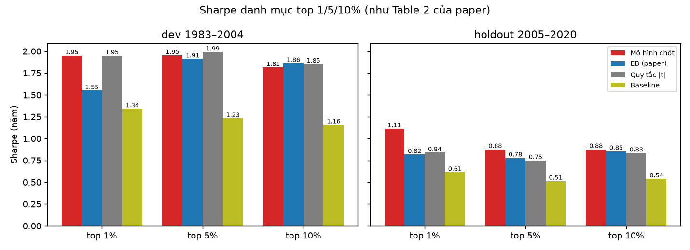
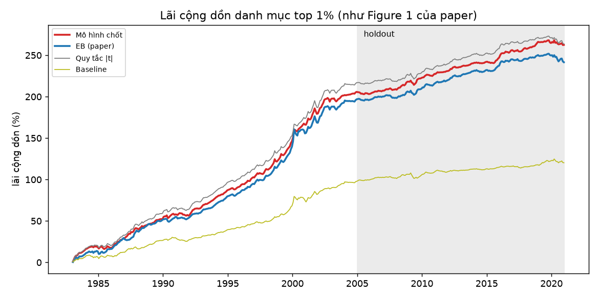
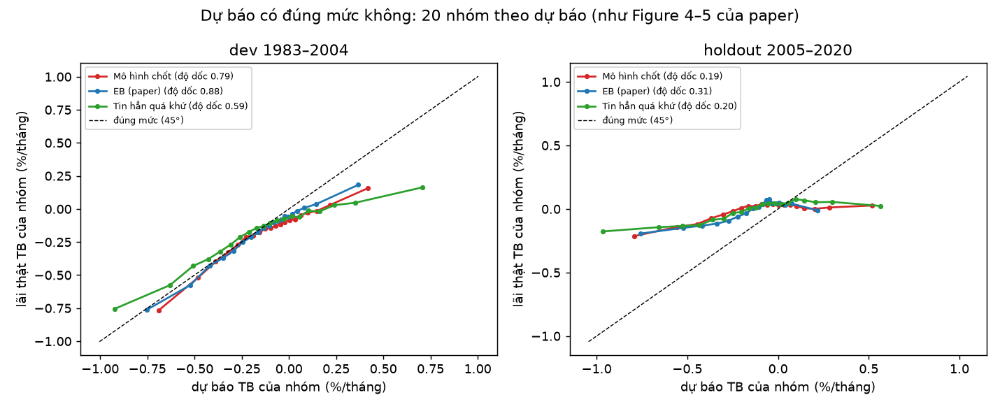
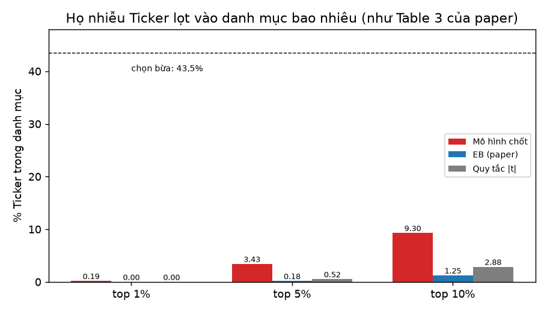

# So sánh với EB theo đúng cách chấm của paper

Paper Chen & Dim chấm EB bằng 4 cách. File này chấm mô hình chốt (seed 1) bằng **đúng 4 cách đó**, đặt cạnh EB.

**Cùng sân:** cả hai chọn trong họ kế toán EW (khoảng 26.000 chiến lược/năm), cùng năm 1983–2020, cùng luật chọn danh mục, chỉ khác con số dự báo. EB do mã dự án chạy lại theo paper. Mã này chạy trên 6 họ cho top 1% Sharpe 1,49 (paper ghi 1,46), nên tin được là đúng EB. Dev 1983–2004 dùng để chọn mô hình; holdout 2005–2020 chỉ để báo cáo.

Số và hình: `code/experiments/eb_compare/make.py` (bảng đầy đủ `table2.csv`).

---

## 1. Danh mục top 1/5/10% kiếm được bao nhiêu (Table 2 của paper)

### 1.1 Sau khi mô hình dự báo xong, paper làm gì (từng bước)

Ví dụ năm 2000, top 1%. Giống một nhà đầu tư thật, đứng ở ngày 1/1/2000:

| Bước | Làm gì | Ví dụ năm 2000 |
|---|---|---|
| 1. Có dự báo | mô hình đoán lãi năm 2000 cho từng chiến lược (chỉ dùng dữ liệu đến hết 1999) | 25.603 chiến lược, mỗi cái một dự báo. 18144: 1,278 %/tháng |
| 2. Chấm điểm | **Sharpe dự báo** = dự báo ÷ độ dao động quá khứ (lãi trên mỗi đơn vị rủi ro) | 18144: 1,278 ÷ 1,982 = 0,645 |
| 3. Chọn | xếp 25.603 chiến lược theo điểm, lấy **1% cao nhất** | 257 chiến lược; 18144 đứng đầu |
| 4. Đầu tư | chia tiền đều cho 257 chiến lược, giữ suốt 12 tháng (dự báo âm thì làm ngược chiều) | |
| 5. Ghi lãi | mỗi tháng, lãi danh mục = trung bình lãi **thật** của 257 chiến lược | tháng 1: +5,00%; tháng 2: +8,86%; tháng 3: −0,24%; … tháng 12: −1,32% |
| 6. Sang năm sau | 1/1/2001: lặp lại bước 1–5 với dự báo mới, danh mục mới | |

Lặp 38 năm (1983–2020) được một chuỗi lãi tháng liên tiếp, như sổ lãi của một quỹ. Cuối cùng chấm quỹ này bằng 3 con số trên **toàn bộ các tháng của giai đoạn** (không phải trung bình từng năm):
- **Lãi %/năm** = lãi tháng trung bình × 12.
- **Sharpe** = lãi tháng trung bình ÷ độ lệch chuẩn lãi tháng × √12. Ví dụ dev: 0,780 ÷ 1,385 × 3,46 = **1,95**. Số quan trọng nhất; trên 1 là rất tốt.
- **t-stat** = lãi có chắc chắn khác 0 không (trên 2 là chắc).

EB làm **y hệt** bước 2–6, chỉ khác bước 1 (con số dự báo). Nên chênh lệch hoàn toàn do dự báo.

### 1.2 Vì sao chia dev và holdout

Giống ôn thi: **dev** (1983–2004) là đề luyện, **holdout** (2005–2020) là đề thi thật.
- Trong quá trình làm, đã thử khoảng 60 cấu hình/seed. **Chỉ được nhìn điểm dev** để chọn cái tốt nhất.
- Holdout **không được nhìn khi chọn**, chỉ mở ra lúc báo cáo. Nếu mô hình chỉ "học tủ" đề luyện thì sẽ trượt ở đề thật.
- Vì vậy **holdout là bằng chứng quan trọng nhất**: hơn EB ở holdout nghĩa là mô hình thật sự tốt, không phải may mắn do chọn nhiều lần.
- Mốc 2004/2005 cũng là mốc paper dùng: sau 2004 tín hiệu yếu đi rõ (thị trường đã biết đến), nên holdout khó hơn dev.

### 1.3 Kết quả

| Danh mục | Kỳ | Lãi %/năm (mô hình / EB) | t-stat (mô hình / EB) | **Sharpe (mô hình / EB)** |
|---|---|---|---|---|
| **Top 1%** | dev | 9,36 / 8,95 | 9,15 / 7,26 | **1,95** / 1,55 |
| | holdout | 3,54 / 2,79 | 4,45 / 3,27 | **1,11** / 0,82 |
| Top 5% | dev | 8,05 / 8,42 | 9,16 / 8,97 | **1,95** / 1,91 |
| | holdout | 2,44 / 2,29 | 3,50 / 3,11 | **0,88** / 0,78 |
| Top 10% | dev | 7,13 / 7,73 | 8,51 / 8,74 | 1,82 / **1,86** |
| | holdout | 2,16 / 2,26 | 3,51 / 3,42 | **0,88** / 0,86 |

Cả kỳ 1983–2020, top 1%: Sharpe 1,62 so với 1,27.

**Đọc:**
- **Top 1%** (danh mục chính của paper): mô hình hơn EB rõ ở **cả đề luyện lẫn đề thi thật**.
- **Top 5–10%:** hai bên gần ngang nhau. Sharpe mô hình cao hơn ở 5/6 ô; ô duy nhất thấp hơn là dev top 10%.
- Mọi con số holdout đều thấp hơn dev cho cả hai bên, đúng như paper: tín hiệu yếu dần sau 2004.

---

## 2. Lãi cộng dồn theo thời gian (Figure 1 của paper)

**Paper làm gì.** Vẽ lãi của danh mục top 1% cộng dồn từ 1983 để thấy tiền tăng đều hay chỉ nhờ vài năm.

**Đọc:**
- Đường mô hình (đỏ) nằm trên EB (xanh) gần như suốt 38 năm, không phải nhờ một vài năm.
- Như paper, mọi đường đều dốc trước 2004 và thoải hẳn sau 2005: tín hiệu yếu dần khi thị trường biết đến.
- Quy tắc |t| (xám) có lãi cộng dồn ngang mô hình nhưng lên xuống mạnh hơn, nên Sharpe thấp hơn ở holdout (0,84 so với 1,11).

---

## 3. Dự báo có "đúng mức" không (Figure 4–5 của paper)

**Paper làm gì.** Đây là điểm paper khen EB nhất. Câu hỏi: *EB đoán một nhóm lãi X% thì thật có lãi khoảng X% không?* Cách làm: mỗi năm chia chiến lược thành 20 nhóm theo dự báo, tính dự báo trung bình và lãi thật trung bình của từng nhóm, rồi vẽ. Nếu các điểm nằm trên đường chéo 45° thì đúng mức hoàn toàn. **Độ dốc** của đường đi qua các điểm bằng 1 là đúng mức; nhỏ hơn 1 là đoán quá tay (nhóm đoán cao thì thật không cao bằng).

| Độ dốc (1 = đúng mức) | Dev | Holdout |
|---|---|---|
| EB | **0,88** | **0,31** |
| Mô hình chốt | 0,79 | 0,19 |
| Tin hẳn quá khứ (không co) | 0,59 | 0,20 |

**Đọc:**
- Ở dev, cả EB và mô hình đều gần đúng mức, tốt hơn hẳn "tin hẳn quá khứ". **EB đúng mức hơn mô hình một chút.**
- Ở holdout, mọi cách đều đoán quá tay (độ dốc thấp), vì tín hiệu yếu đi sau 2005. Paper cũng ghi nhận điều này cho EB.
- Nghĩa là: mô hình **xếp hạng** tốt hơn (chọn đúng top 1%), nhưng **độ lớn** con số dự báo thì EB chuẩn hơn.

---

## 4. Có bị lừa bởi chiến lược nhiễu không (Table 3 của paper)

**Paper làm gì.** Paper đưa vào họ **Ticker**: chiến lược xếp theo chữ cái tên mã cổ phiếu, cố tình vô nghĩa. Một phương pháp tốt phải tự nhận ra đây là nhiễu và không chọn chúng. EB chọn 0% Ticker vào top 1%.

**Làm tương tự:** trộn Ticker EW với kế toán EW mỗi năm (Ticker chiếm 43,5% số chiến lược). Mô hình **không học lại và chưa từng thấy Ticker**. Nếu chọn bừa thì 43,5% danh mục sẽ là Ticker.

**Đọc:**
- Top 1%: mô hình chỉ có 0,19% Ticker. 33 Ticker lọt vào trong 38 năm có lãi thật −0,07%/tháng, tức là đúng nhiễu. **Mô hình nhận ra Ticker là nhiễu**, giống paper.
- Top 5–10%: mô hình lẫn nhiều Ticker hơn EB (3,4% và 9,3%, so với 0,2% và 1,3%). EB co nhiễu mạnh hơn.
- Danh mục gộp, top 1%: mô hình vẫn hơn EB (dev 2,02 so với 1,72; holdout 1,05 so với 0,75).

Chi tiết: `code/experiments/ticker_test/`, mục 3b của [6_ALL_RESULTS_SUMMARY.md](6_ALL_RESULTS_SUMMARY.md).

---

## 5. Thêm: IC (không có trong paper)

IC = tương quan thứ hạng giữa dự báo và lãi thật trên **mọi** chiến lược của năm (không chỉ top).

| | Dev | Holdout |
|---|---|---|
| Mô hình chốt | 0,151 | **0,043** |
| EB | **0,188** | 0,021 |
| p | 0,013 (EB hơn) | 0,49 (ngang) |

Ở dev, EB xếp toàn bộ danh sách tốt hơn. Mô hình hơn ở đúng phần quan trọng là đầu bảng (top 1%).

---

## Tóm lại

| Cách chấm của paper | Ai hơn |
|---|---|
| Table 2: Sharpe top 1% | **Mô hình**, có ý nghĩa ở dev, holdout và cả kỳ |
| Table 2: Sharpe top 5%, 10% | ngang nhau |
| Figure 1: lãi cộng dồn | **Mô hình** cao hơn đều suốt 38 năm |
| Figure 4–5: đúng mức | **EB** nhỉnh hơn (độ dốc 0,88 so với 0,79) |
| Table 3: tránh nhiễu Ticker | top 1%: cả hai gần 0. Top 5–10%: **EB** sạch hơn |

**Một câu:** mô hình chọn danh mục top 1% tốt hơn EB một cách có ý nghĩa thống kê, kể cả sau 2005. EB vẫn hơn ở độ đúng mức của con số dự báo và ở khả năng loại nhiễu ngoài top 1%.

**Giới hạn:** mới so trên họ kế toán EW, nơi chứa 91% danh mục top 1% của EB (Table 3 của paper). Chưa so được với con số tổng 6 họ của paper.
